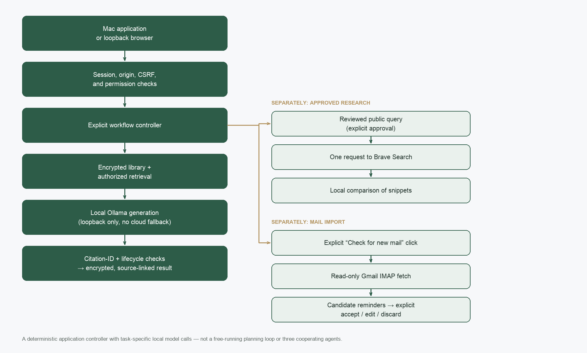

<p align="center">
  
</p>

# Lumen

A single-user, local-first personal AI assistant for a laptop or Mac mini. Lumen runs **FastAPI + Ollama** with a **Mac menu-bar app**, a chat-first interface, and an encrypted SQLite vault. It replaces the previous Maple application; there is **no email-sending capability**. Optional, off-by-default, read-only Gmail import is available; see [Mail import](#mail-import-read-only-optional).

## Why Lumen instead of a bare Ollama session or another AI agent

Running `ollama run <model>` gives you a local model and nothing else: no memory across sessions, no document ingestion, no permission model, and no safeguard against pasting something you forgot was sensitive. Most other "AI agent" products solve that by adding autonomy and cloud services, which trade away the privacy a local model was supposed to give you. Lumen's position is specific, not just "also local":

| Compared to... | What that option gives up | What Lumen does instead |
|---|---|---|
| **A bare Ollama / `ollama run` session** | No persistent, inspectable memory; no document import or citation tracking; no encryption at rest; no notion of "this file is allowed in prompts" versus "this file is private"; copy-pasting context is manual and leaves no audit trail. | Documents, notes, drafts, and reminders live in an **AES-256-GCM encrypted SQLite vault**, each with its own **explicit AI-access flag**. Retrieval cites the exact chunk/source used, so an answer is traceable back to a specific saved record instead of "whatever was in the terminal scrollback." |
| **Most cloud AI agents (ChatGPT-style agents, browser/OS "copilots")** | Your documents, clipboard, and conversation typically leave your machine; the vendor's retention/training policy applies; agent frameworks often execute tool calls (web actions, file writes, sending messages) with limited per-step user review. | Inference never leaves `127.0.0.1:11434`; there is **no cloud model fallback, ever** (checked in code, not just documentation). The one external capability — Brave search — requires you to **review the exact frozen query** and approve it per-request; it is never triggered automatically by the model. |
| **"Autonomous" personal-agent frameworks (auto-GPT-style loops, always-on assistants)** | These are built to take multi-step actions on your behalf — sending mail, deleting files, browsing — often after a single broad consent, because autonomy is the product. | Lumen is deliberately **not** an autonomous executor. It cannot send email, read a calendar, control other apps, or poll your clipboard/microphone in the background. Every write (saving a note, creating a reminder, deleting a record) is a **single explicit action you took**, and deletions require a **one-time, revision-bound approval** so a stale confirmation can't silently delete something newer. |
| **Generic local-LLM chat UIs (LM Studio, Open WebUI, and similar)** | These are good at "chat with a local model," but typically treat all imported context as always-on for the model, and don't distinguish "stored for me to read later" from "allowed into prompts." | Every document and note carries an independent **authorize / revoke** toggle. Revoking access removes a record from retrieval immediately, including mid-request; the model never silently retains something you just turned off. |
| **Skipping a UI and scripting Ollama yourself** | Workable for one person who remembers their own conventions, but there's no session lock, no encrypted-at-rest guarantee, no approval trail, and no natural place to keep notes/reminders/drafts next to the chat that created them. | A single **passphrase-locked workspace** (30-minute auto-lock) ties chat, memory, documents, drafts, and reminders together, with the permission and approval model enforced by the server, not by developer discipline at call time. |

None of this claims Lumen makes a model more accurate, immune to prompt injection, or safe against malware already running as you — see [Privacy and threat boundary](#privacy-and-threat-boundary) for the actual limits. The claim is narrower: **if you want a local model with real memory, explicit per-record permissions, and no autonomous or cloud-dependent behavior, Lumen implements that as enforced server behavior, not as a configuration option you could get wrong.**

## Start here

- **Using Lumen:** read the short [everyday user guide](docs/user-guide.md).
- **First installation:** follow [Run locally](#run-locally), then optionally build the [Mac app](#the-mac-app-one-click-no-terminal-each-day).
- **Checking what is finished:** see [Current implementation status](#current-implementation-status).
- **Developing/testing:** see [evaluation instructions](docs/evaluation/README.md) and the separate [synthetic-only LangSmith guide](docs/evaluation/langsmith.md). Neither is required for daily use.

## The Mac app: one click, no terminal each day

The native app requires macOS 13+ and Apple's Command Line Tools. After installing Python dependencies as shown below, build/install it once:

```sh
.venv/bin/python scripts/install_macos.py --install
open "$HOME/Applications/Lumen.app"
```

Lumen lives in the menu bar. Click the sparkle icon or press **Control + Option + Space** to open its chat window. Closing the window **does not quit the assistant**. Use **Quit Lumen** in its menu when you actually want to stop it. If the shortcut is already in use, Lumen explains the conflict and the menu icon remains available.

Choose **Start at login** in the Lumen menu to opt into automatic startup. Approve it in **System Settings > General > Login Items** if macOS requests approval. Uncheck it to disable. It is not enabled silently. The app runs while your Mac is awake and logged in—not when the machine is off/asleep. The icon remains available when the vault is locked; unlock to access personal information.

No browser, port selection, or server command is needed day to day. The app starts its own loopback-only Python backend on an OS-assigned port. A crash gets one automatic restart; persistent failures are shown with **Restart local service** available in the menu. Quitting stops the owned process; the backend also watches its parent so it exits if the native app crashes. Use one Lumen instance at a time, and stop an old terminal-run server before switching to the Mac app.

The app references this project folder and its `.venv`; **keep both in place**. It is locally compiled and ad-hoc signed, not a self-contained/notarized distributable. To rebuild, quit and move the specific old `Lumen.app` aside first; the installer refuses to overwrite an existing app.

### A simpler chat workflow

Chat is now the first screen, in both the Mac app and browser:

- **Ask / suggest:** ask a question or request small, concrete next steps for a Mac app.
- **Save a note:** type the note and save directly from chat, including any visibly shared text, without using the model. AI memory remains opt-in.
- **Remind me:** type what to remember and choose a local date/time inline. Visible shared text is included as details; no guessed dates.
- **Draft an email:** describe what to say and optionally share text from a message; review/edit the result in a small dialog before saving. Nothing is sent.

On first unlock, Lumen picks an installed local model automatically if no model is configured. Settings can change it later. If Ollama/models are unavailable, a setup notice explains what is needed; notes and reminders still work without AI. The Mac menu includes **Open Ollama**; model installation/download remains your choice.

Unlock/setup checks also validate an already configured model. If that model has been removed or Ollama is stopped, Lumen shows guidance rather than silently selecting a replacement. Settings embedding validation shares the same busy-task guard as other model work.

### Suggestions from context you choose

Copy selected text in another Mac app, then choose **Share clipboard text** from Lumen's menu (or **Clipboard text** in chat). Lumen reads the clipboard **only after that explicit action and only when unlocked**. Inspect/edit the preview, optionally name the app, and ask for suggestions. Merely sharing/preparing context does not send it to a model.

Sharing uses live server authorization, not the cached unlocked display state. The Mac app revalidates after a file chooser before reading file contents, and text/file delivery is bound to the same session generation. These are checkpoints: a read already in progress cannot be recalled, but stale results are discarded instead of inserted into a new session.

Choose **Share a file** or **Attach file** to review its selected filename and consent options. This is not a full document-content preview; inspect extracted text in Documents after import. Before asking, explicitly allow AI access and storage of an encrypted extracted-text library copy. Removing an attachment only removes it from the current request; revoke access/delete its saved copy in Documents if desired. File Q&A uses up to two selected excerpts; use **Documents > Summarize** for a full-document summary.

There is **no screen capture, Accessibility permission, app-content monitoring, automatic clipboard polling, installed-app inventory, or control of other apps**. Suggestions rely on what you tell/share with Lumen and may need the app's version. Shared text/app labels are retained encrypted with their conversation turn and can be inspected/deleted there. They enter later context only when you explicitly enable recent chat.

Shared text can also be saved in a note/reminder or supplied to email drafting. Attached files are used only by **Ask / suggest**; remove the attachment before choosing another action. Notes/reminders and draft saving clear the shared text afterwards to avoid accidentally reusing it.

The full workspace remains available from the compact window's view selector for documents, saved drafts, memory, reminders, research, and settings.

### Speak to Lumen

Choose **Speak to Lumen** in the menu bar, **hold `.` and press Enter while Lumen is focused**, or click **Speak to Lumen (. + Enter)** in the Mac chat window. Unlock first. The voice chord works only in Lumen's chat/window or recording sheet, not other apps or the locked passphrase screen. It uses only local app events; no global keyboard monitoring, Input Monitoring, or Accessibility permission is requested. Control + Option + V is no longer registered. **Control + Option + Space** still opens Lumen globally. On first use, macOS asks for **Microphone** and **Speech Recognition** permission; access is requested only after you initiate speaking.

While listening, the menu icon becomes a red microphone and a recording window shows status and partial text. Click **Stop & review** or **hold `.` and press Enter again with Lumen focused** to stop. If another app is focused, use the menu-bar stop action or bring Lumen forward first. Releasing `.` before pressing Enter is ordinary typing, not the chord; normal periods are delivered on release or before the next typed key, and holding `.` long enough to auto-repeat types periods normally. The chord consumes its own period/Enter without adding punctuation or submitting a form. Recording stops automatically after 60 seconds. **Cancel** / Escape discards it. Closing/hiding/quitting Lumen, locking the vault, sleeping/switching the Mac session, or losing the owned backend cancels capture. There is no always-listening mode or wake word.

The recording window identifies the system-default input device and shows a live input-level meter; these measurements stay in memory. For an empty transcript, Lumen distinguishes no incoming audio buffers, a silent/very quiet signal, and audio received without recognized words. Check **System Settings > Sound > Input**, headset mute/connection, and input volume if the meter does not move. Speak only after recording starts, using the indicated Dictation language. Recognition errors retain their domain/code, and an empty final result never erases partial text or hides a simultaneous error.

Stop ends microphone input and explicitly finishes Apple's buffered recognition task. If recognition still fails or times out after displaying words, choose **Review partial text** to put those words in chat yourself. They are labeled **possibly incomplete**, require review/editing, and are never automatically sent or saved. If there are no words, this recovery action is unavailable; Lumen never invents a transcript or silently falls back to cloud recognition.

Recognition is **on-device only**: Lumen checks local language support and sets `requiresOnDeviceRecognition = true`. No cloud fallback is permitted. Your Mac's current language is used; unsupported languages/devices, missing microphones, denied permissions, recognition errors, and finalization timeouts are explicitly reported. If the final transcript cannot be obtained, partial text is shown as incomplete and can be copied explicitly—never silently treated as a final answer. Lumen does not save audio recordings.

The finalized transcript is **appended to the chat input**, preserving typed text and the selected Ask/Note/Reminder/Draft action. Review/edit it and press the action button yourself. It is **not automatically sent to Ollama, saved as a note, or shared externally**. Lock/session changes invalidate an in-flight transcript, and overflow leaves your original input unchanged. Recording cannot start while a chat action or review dialog is in progress. Avoid dictating credentials.

This uses Apple's native speech APIs, not browser/cloud dictation. The browser-only interface has no microphone option. Speech accuracy and hardware capture must be evaluated with your own explicit recording; automated checks do not activate the microphone or grant OS permissions.

## Run locally

Python 3.11+ is required. [Ollama](https://ollama.com/) and an installed local model are required for AI features, not for saving notes and reminders.

```sh
python3 -m venv .venv
source .venv/bin/activate
pip install -e .

# Start the Ollama desktop app (or ollama serve).
# An existing downloaded local model works; downloading this model is optional.
ollama pull qwen3:4b
lumen
```

Open **http://127.0.0.1:8765**, create a passphrase of at least 12 characters, then open **Settings & privacy**, refresh the model list, select a downloaded model, and save. Neither server should be exposed to the LAN or internet. Hosted/cloud Ollama models are rejected. Model quality, available memory, and context size affect performance.

```sh
# Optional: a separate encrypted vault and another loopback port.
lumen --port 8766 --data-dir /path/to/private-lumen-data
# Equivalent without the installed entry point:
python -m lumen
```

Stop with `Ctrl+C`. Restart and unlock to resume. **There is no passphrase recovery or passphrase-change workflow.** The default vault is `~/.lumen/lumen.sqlite3`. The previous application's `~/.maple` data is not migrated, accessed, or deleted.

## Core workflows

| Workspace | Behavior |
|---|---|
| My day | Counts, upcoming/overdue reminders, recently saved notes and documents, and quick actions. |
| Documents | Explicitly import PDF, Word `.docx`, UTF-8 TXT, or Markdown; enable local AI access per document; summarize with a chosen focus and source labels. View extracted text and saved summaries. |
| Assistant | Answer questions from authorized document/note chunks, with retrieved source links. Conversation is persisted encrypted. Using the last two eligible turns as context requires checking **Use recent conversation**. |
| Notes & memory | Create, edit, inspect, authorize/revoke, and delete notes. Explicitly saved and authorized preferences/corrections guide local answers; there is no hidden automatic preference extraction. |
| Email drafts | Give instructions and a tone to generate a local draft, revise it, and explicitly save. Or write one yourself. Copy reviewed text to your clipboard; Lumen cannot send it. |
| Reminders | Create/edit an exact timezone-aware due date, inspect overdue reminders, mark complete, and reopen. These are in-app reminders, **not OS notifications**. Candidate reminders suggested from imported mail appear here for explicit accept/edit/discard; nothing from email becomes a reminder automatically. |
| Research | Manually write a public query, review exactly what would leave the laptop, approve once, and compare Brave search snippets locally with references. Edit selected findings before saving them as a note. |
| Mail (optional, under Saved) | Connect a Gmail account with a read-only IMAP app password, then explicitly click **Check for new mail** to import recent inbox messages and extract candidate reminders. See [Mail import](#mail-import-read-only-optional). |

Chat is a grounded Q&A workflow, **not an autonomous action executor**. Writes happen through explicit inline controls or workspace forms. The assistant cannot silently save notes, create reminders, send mail, delete records, browse websites, or generate external queries. Each action uses the actual tool/server result; errors are surfaced rather than reported as completion. Follow-up questions, refocused summaries, editable drafts, revised searches, and preference notes provide feedback between steps.

### Documents and retrieval

Imports are copied as **extracted text**, encrypted in the vault; original file bytes are not retained or modified. Limits: 12 MiB per upload, 400 PDF pages, 600,000 extracted characters, and 30 MiB of expanded `.docx` contents. `.doc` is unsupported; convert it to `.docx`. Scanned/image-only PDFs need OCR before import. Layout, handwriting, images, headers, and footers may not be extracted faithfully. Parsers run in the application process, not an OS sandbox; import trusted files.

Chunks have a conservative UTF-8 byte budget and overlap. Large summaries process **every chunk** in batches, then recursively combine the partial summaries; they can take several minutes. This does not guarantee that a final summary preserves every fact. A context-budget overflow or output-limit truncation is an explicit error, not a silently saved partial answer. Try a narrower focus or larger-context model.

Retrieval defaults to local **keyword overlap**. To opt into **semantic retrieval**, first install a local embedding model with `ollama pull nomic-embed-text`, then enter `nomic-embed-text` in **Settings > Optional local embedding model** and save. This is separate from the chat model; embedding-only models are excluded from the chat-model picker. Clear the embedding setting to return to keyword search. Model downloads are your choice; Lumen never downloads one automatically.

Semantic search embeds the question and authorized document/note chunks using loopback Ollama, ranks chunks by cosine similarity, and supplies at most **two** with scores of at least **0.5**. This cutoff is a heuristic, not evidence validation or a calibrated confidence score. The recommended model uses `search_query:` / `search_document:` prefixes. Title and chunk text are embedded together; document/page locations and source labels remain available for inspection. The chat shows the retrieval method and number of excerpts used. Explicitly attached files restrict the search to those files. Semantic search does not substitute the opening paragraphs when no relevant chunk passes the cutoff; legacy keyword attachment fallback remains unchanged.

Vectors are recomputed in batches of up to 16 chunks for each question and are not persisted or cached. This keeps the prototype simple and avoids a separate plaintext vector index, but becomes slower as the library grows. Only authorized records are embedded, and permissions/revisions are rechecked between embedding batches and before/after generation. Embedding errors are explicit; semantic search never silently falls back to keyword search. Both methods can miss relevant passages or cross-document connections; use full-document summarization when appropriate.

Up to two authorized preferences (300 characters each) and, when enabled, two recent eligible turns (300 user/600 assistant/600 shared-context characters each) enter the prompt. Longer preferences/history are intentionally bounded.

Source IDs are checked against supplied sources: invented `[S999]`/`[W999]` labels fail rather than being saved. **Citation existence is not factual/evidence validation.** Always inspect the source before relying on a date, amount, legal/medical statement, or other important conclusion. Clarification and uncertainty are model-prompted behavior and need evaluation, not guarantees.

Revoking AI access immediately excludes a record from new retrieval and discards in-flight answers if access/revisions change before saving. Prior conversation derived from revoked/deleted sources or preferences is excluded from subsequent history context. Saved summaries and old conversations remain visible to you until individually deleted. Manually copied findings are independent records with their own permission controls.

Full-document summaries recheck document access before and after each section and combination call. Revocation, deletion, or revision changes stop further model work at the next checkpoint and leave any earlier saved summary unchanged.

### Approved internet research

Create a [Brave Search API](https://brave.com/search/api/) account and save the API key in **Settings & privacy**. It is encrypted and never returned to the browser. Blank input retains the saved key; **Remove the saved Brave API key** removes it.

1. Type a public query containing no personal information.
2. Review the exact frozen query, destination, and disclosure.
3. Click **Approve & search** to allow one request to Brave.

Approvals expire after ten minutes, cannot be reused, and are cancelled when the vault locks or a new unlock replaces the session. Changes require a new review. Email-address/SSN-shaped query checks catch some obvious mistakes, **not all sensitive information**. Privacy depends on your review; Lumen does not use an AI redaction guarantee.

Only the query, configured search options, and API credential are sent to Brave—never document text, notes, drafts, reminders, or conversation history. Brave also sees network metadata such as your IP. Its terms, retention, and billing apply. No external request is made at preview time; redirects, proxy environment variables, and automatic retries are disabled.

Research compares **search-result descriptions, not full article text**. It is an initial source-discovery aid, not a full web-research engine or verified fact-checker. No source page is fetched automatically. Clicking a clearly displayed source link intentionally contacts that website in your browser. If the local model fails after search, retrieved references remain saved with an incomplete/error status. If search itself times out, the approved query may already have reached Brave; Lumen says so and does not retry.

Deleting a research record while its local comparison is running takes precedence over late completion: neither a successful answer nor an error write recreates the deleted record.

### Mail import (read-only, optional)

Lumen can connect to a **Gmail account over read-only IMAP** to find deadlines and appointments in your inbox and suggest reminders. This is **off by default** and entirely separate from the main app permission model described above; read it before connecting an account.

1. In **Settings & privacy > Optional mail import**, enter your Gmail address and a [Google app password](https://support.google.com/accounts/answer/185833) (not your regular account password). Saving validates read-only access immediately and stores the password encrypted; it is never returned to the browser. **Disconnect this mail account** removes it.
2. In **Saved > Mail**, click **Check for new mail**. Nothing happens automatically or in the background: import only happens on this explicit click, and only while Lumen is open.
3. Each check fetches inbox messages from the **last 90 days**, bounded to **200 messages per check**, using `BODY.PEEK` so messages are never marked as read. Already-imported messages (matched by `Message-ID`) are skipped. Imported messages are stored encrypted in the vault, same as documents and notes, and are inspectable/deletable the same way.
4. Newly imported messages are sent to your local model in small batches, asking it to find **explicitly stated** dates and propose a reminder title/date/detail. The model is instructed never to guess a date; its output is parsed and validated (a malformed or out-of-batch reference is dropped, not guessed at). This is a **best-effort suggestion, not a verified extraction** — always check the suggested date against the actual email.
5. Suggestions appear in **Reminders > Suggested from your email**. **Accept** saves them as a normal reminder as-is; **Edit before accepting** lets you change the title/date/details first; **Discard** removes the suggestion. Nothing becomes a real reminder without one of these explicit actions.

Other properties, matching the rest of the app's design:

- **Read-only, never send:** Lumen has no SMTP capability and cannot reply, delete, label, or modify anything in your mailbox.
- **No background sync:** there is no scheduled or continuous mail checking; the app has no background process at all (see [the Mac app section](#the-mac-app-one-click-no-terminal-each-day)).
- **Per-message authorization:** imported mail defaults to AI-access-allowed (since the only purpose of importing is for Lumen to read it for deadlines), but each message can be individually revoked or deleted afterward, same as documents/notes.
- **Included in Assistant retrieval:** authorized mail content is searchable the same way as authorized documents/notes, so you can ask things like "when does my flight depart" and get a cited answer from an imported email.
- **In-app alerts only:** suggested/accepted reminders surface in **My day** and **Reminders** while Lumen is open and unlocked, exactly like any other reminder. There are **no OS push notifications** for mail-derived reminders; see [the Reminders row above](#core-workflows).
- **HTML mail:** Lumen extracts plain text from HTML-only messages without rendering markup, executing scripts, or fetching remote images.

## Privacy and threat boundary

- Server binding is fixed to `127.0.0.1`. The app enforces the exact Host/Origin, blocks cross-site browser requests, uses an HttpOnly SameSite session cookie and session-bound CSRF checks, and has no CORS or embedded third-party resources.
- Inference calls only `http://127.0.0.1:11434`, ignoring proxy environment variables. Model metadata is checked for remote backing before each call. Use a trusted local Ollama installation; a compromised or modified local service could lie.
- Records are encrypted using **AES-256-GCM**, unique random nonces, and authenticated record identity. **Scrypt** derives a key from your passphrase; the key is held in process memory while unlocked. All stored record contents, including the saved Brave key and mail app password, are encrypted. The optional LangSmith export key is supplied to its explicit command and is not stored by Lumen.
- Random record identifiers, record kinds/counts, approximate encrypted sizes, and vault salt/verifier are visible in SQLite. File/directory permissions are `600`/`700`. HTTP access logs are disabled. There is no runtime analytics, cloud LLM SDK, tracing hook, CDN, credential export, or automatic upload. A separate development command can export only explicitly confirmed synthetic evaluation traces to LangSmith; normal app usage is not traced.
- The vault locks after **30 minutes without an action**; polling/read-only views do not keep it unlocked. A periodic server task expires sessions even without a browser. Only the unlocking browser session may access the vault. Locking clears approvals and discards in-flight results at their next checkpoint. An already-issued model/search request cannot be recalled.
- Deletions require a reviewed, single-use, revision-bound approval. Ordinary deletion is **not guaranteed secure erasure**, despite SQLite's `secure_delete`. Copies in other notes/conversations and backups remain.
- Clipboard copying is an explicit local action; other applications and OS clipboard synchronization may access it. Avoid copying sensitive drafts if you use a cloud-synced clipboard.

This protects vault contents **at rest**, not against malware/other processes running as your user, root, a compromised browser/extension/model runtime, memory dumps, unencrypted swap, or physical access to an unlocked device. Python cannot guarantee erasure of all plaintext memory copies. Enable **FileVault/full-disk encryption**, use a strong unique passphrase, and keep your OS/browser updated. Do not add tunnels, public listeners, reverse proxies, or port forwarding.

Dependency/model downloads, optional Brave queries, optional explicit Gmail IMAP checks, manually opened reference links, and explicitly confirmed LangSmith synthetic-evaluation exports use the internet. Normal workflows otherwise work offline once a local model is installed. Availability requires the hosting device to be awake. The menu-bar app supports opt-in macOS login startup; no system-wide daemon or public service is installed. It additionally requests a vault lock when the Mac sleeps or the user session becomes inactive; these notifications are best effort, with the normal idle timeout retained as a fallback. No passphrase or vault key is saved in login preferences.

## Architecture

```text
Loopback browser
  -> session / CSRF / exact origin boundary
  -> explicit workspace tools + single-use approval controller
  -> encrypted SQLite vault
  -> authorized keyword or opt-in semantic retrieval / batched summaries
  -> loopback Ollama (no cloud fallback)

User-approved public query only -> fixed Brave Search API
Brave snippets -> encrypted research record -> local comparison -> reviewed note

Explicit "Check for new mail" only -> read-only Gmail IMAP (user's own saved app password)
Fetched messages -> encrypted mail_message records -> local extraction -> candidate reminders -> explicit accept/discard
```



`lumen/app.py` coordinates tools, permissions, sessions, approval lifetimes, and workflows. `storage.py` owns encryption, `documents.py` owns extraction/chunking/retrieval, `inference.py` owns loopback model access, `research.py` owns the app's optional external search call, `mail.py` owns the optional read-only IMAP fetch and candidate-reminder extraction/validation, and `static/` contains the interface. `native/Lumen.swift` owns the menu bar, shortcut, explicit clipboard/file sharing, nonpersistent WKWebView, and opt-in login setting. `desktop_server.py` owns the native app's backend lifecycle. The native web view restricts navigation/bridge calls to its own loopback service; explicitly clicked source links open in the default browser. Separately, `langsmith_export.py` supports previewed synthetic evaluation exports without instrumenting the app. No Node build step or framework is needed.


Every record's path between private, authorized, and deleted goes through an explicit action — there is no path that grants AI access, or removes a record, without one:


All three diagrams are generated directly from the architecture described above — not hand-drawn — by [scripts/render_architecture_diagram.py](scripts/render_architecture_diagram.py); regenerate them with `.venv/bin/python scripts/render_architecture_diagram.py` if the architecture changes.

### Retrieval checkpoint demonstration

The short submission and observed example are in [docs/retrieval-checkpoint.md](docs/retrieval-checkpoint.md). With development dependencies installed and Ollama running, reproduce the synthetic comparison without touching your real vault:

```sh
# Install these models only if you choose to download them.
ollama pull nomic-embed-text
ollama pull llama3:latest
.venv/bin/python scripts/demo_retrieval.py
```

The script creates a temporary vault, imports a synthetic household guide, and asks the same question with keyword retrieval, semantic retrieval, and then revoked document access. It prints answers, source excerpts, scores, and retrieval metadata, and fails explicitly if the semantic answer omits the source's savings amount/citation or revoked evidence is reused. Model wording can vary.

## Checks and capstone evaluation

```sh
pip install -e '.[dev]'
pytest -q
ruff check lumen tests scripts
node --check lumen/static/app.js

# Opt-in browser workflow check. Uses installed Chrome on macOS.
LUMEN_BROWSER_TESTS=1 pytest -q tests/test_browser.py tests/test_browser_guards.py
LUMEN_NATIVE_TESTS=1 pytest -q tests/test_native.py
# For other systems, install the test browser first:
python -m playwright install chromium

# Opt-in smoke check with synthetic data against your running local Ollama.
LUMEN_LIVE_MODEL=llama3:latest pytest -q tests/test_live_model.py
```

Default tests use synthetic files, temporary vaults, mocked inference, and mocked HTTP transports. They do not read a real mailbox, send emails, contact Brave, or use your personal data. Browser, native-window, and live-model checks are opt-in. The native check uses an isolated temporary vault, never reads your clipboard, and does not change login settings.

For the capstone, evaluate model accuracy separately from deterministic permission behavior:

| Measure | Suggested procedure |
|---|---|
| Summary accuracy | Use a set of PDF/Word fixtures with known facts/dates, human-score omissions and unsupported claims, and inspect citations. Include long, scanned, malformed, and table-heavy documents. |
| Retrieval quality | Ask answerable/unanswerable questions and synonym-based questions. Measure relevant chunk retrieval, answer correctness, and correct abstention; keyword retrieval has known limitations. |
| Permission compliance | Put unique synthetic secrets in unauthorized documents/notes. Inspect intercepted model payloads before/after authorization, revocation, and deletion. Test revocation while inference is running. |
| Approval compliance | Confirm preview makes no external calls. Test cancellation, expiry, reused confirmations, lock invalidation, frozen queries, and revision-bound deletion. |
| Failure reporting | Stop/mock Ollama, fail Brave, exceed budgets, and return invented citations. Verify no success-shaped answer is saved; inspect retained research evidence. |
| Persistence | Restart and unlock; verify notes/history/reminders/drafts survive, the wrong passphrase fails, and record contents are absent from raw database bytes. |

Automated workflow tests establish application behavior with fixtures; they **do not certify a particular model's accuracy or prompt-injection resistance**.

### Scored synthetic evaluation (opt-in)

An 18-case, versioned dataset and a separate evaluation runner now support Q&A, summaries, drafting, missing/conflicting/stale evidence, prompt injection, high-impact advice, permission/history changes, and invalid input. The evaluator uses only bundled synthetic fixtures and temporary vaults, never your personal vault. It measures request/setup timing, model calls, and automatic checks; factual quality requires explicit human scoring.

```sh
# Offline validation: no model or network calls.
.venv/bin/python scripts/evaluate.py validate

# Explicit local inference; replace the example with an installed model.
.venv/bin/python scripts/evaluate.py run --live --model llama3:latest
# Optional semantic comparison, using an already installed embedding model:
.venv/bin/python scripts/evaluate.py run --live --model llama3:latest --embedding-model nomic-embed-text
```

Each run creates a private, Git-ignored directory under `evaluation-results/` with JSON results, a readable review packet, timing/call summaries, and an unfilled human-review template. Fill that template using the [rubric](docs/evaluation/rubric.md), then score it locally:

```sh
# Replace RUN_ID with the directory printed by the runner.
.venv/bin/python scripts/evaluate.py score evaluation-results/RUN_ID/report.json --reviews evaluation-results/RUN_ID/review-template.json
```

See the [evaluation guide](docs/evaluation/README.md) for metric definitions, failure handling, and reproducibility limits. Missing human judgments remain unknown; simulated test runs are never reported as model-quality measurements. **No live, human-scored baseline or achieved quality target has been established yet.** These are development evaluations, not production telemetry or an automatic deployment gate.

### Optional LangSmith: synthetic evaluations only

The evaluator can export recorded case/model spans, final synthetic responses, and optional numeric human feedback to a private LangSmith project. It never traces normal app use. `run`, `score`, and `langsmith-preview` remain local; global SDK tracing variables do not enable uploads.

```sh
# Offline preview; replace RUN_ID and PROJECT_UUID with your actual values.
.venv/bin/python scripts/evaluate.py langsmith-preview evaluation-results/RUN_ID/report.json --project-id PROJECT_UUID
```

Review the exact generated JSON and printed SHA-256, then follow the [LangSmith guide](docs/evaluation/langsmith.md) to explicitly confirm an upload with a locally supplied API key. No SDK installation is required. Only allowlisted US/EU HTTPS endpoints are supported; redirects, automatic retries, and replay of attempted previews are blocked. Reports stay local if the service fails. LangSmith receives approved data and network metadata; its terms, retention, and billing apply. **Do not paste API keys into chat or commit them.**

## Current implementation status

As of November 18, 2026, **not all documented plans are implemented**:

| Area | Actual status |
|---|---|
| Core workflows and Phase 0–2 fixes | Implemented in source with regression tests. Native sharing changes require rebuilding the installed app; actual OS/microphone behavior still needs explicit manual verification. |
| Phase 3 evaluation tooling | Implemented: 18 synthetic cases, local runner, timing/call reports, rubric, and human scoring. A real, human-scored baseline remains pending. |
| LangSmith | Implemented as previewed, hash-confirmed synthetic-only trace/feedback export. No runtime tracing; real account/dashboard verification remains pending. |
| Phase 4 multi-agent workflow | Not implemented. No Evidence/Response/Review pipeline or bounded revision loop is active. |
| Phase 5 intervention controller | Not implemented. Existing approvals are real, but formal risk-based clarification/escalation states remain planned. |
| Phase 6 production observability/rollout | Not implemented. Evaluation timing and optional LangSmith export are not production monitoring or automatic deployment controls. |
| Simpler UI (UI-1) | **Implemented:** readability/contrast fixes and an actionable empty-chat state. Verified with `LUMEN_BROWSER_TESTS=1 pytest -q` (141 passed, 2 skipped). |
| Settings/Ollama coupling | **Fixed:** saving Settings only contacts Ollama when the chat or embedding model changes; removing the Brave key works even when Ollama is offline. |
| Saved-item navigation and guided settings (UI-2/UI-3) | **Implemented:** Documents/Notes/Email drafts/Mail consolidated under one **Saved** page with tabs; saved views are list-first with search and explicit New/Edit panels; Settings split into independent Local AI model / Document search / Web research / Mail import sections. UI-4 (human usability testing) remains proposed; see the [UI experience plan](docs/ui-experience-plan.md). |
| Gmail mail import (read-only, optional) | **Implemented:** read-only IMAP import via an app password, explicit "Check for new mail" trigger (no background sync), local candidate-reminder extraction with explicit accept/edit/discard, and inclusion in Assistant retrieval when authorized. See [Mail import](#mail-import-read-only-optional). |

The [documentation/implementation audit](docs/documentation-implementation-audit.md) records identified gaps and their resolution status. The [implementation plan](docs/implementation-plan.md) tracks fixes separately from the **proposed**, not yet implemented [multi-agent architecture](docs/multi-agent-architecture.md) and [safety/intervention extensions](docs/safety-and-intervention-plan.md). The capstone report dated November 17 is a snapshot from before the later evaluation/export/UI tooling, not a live implementation-status document.

## Backups and future scope

Stop the server before backing up the entire chosen data directory. Backups contain encrypted personal records and the Brave key and still need the passphrase. Keep them private. A fresh `--data-dir` creates a separate vault; there is no plaintext export of your personal vault or destructive reset button. Synthetic evaluation reports/exports are separate developer artifacts, not vault exports.

Outlook/calendar integration, iMessage/WhatsApp, OS notifications, voice notes, scheduled briefings, breach monitoring, and spam cleanup are **not implemented**. They should be added only after the core permission and accuracy evaluation, with scoped authorization, channel-specific disclosure settings, and explicit approval for sending/deleting/sharing.
