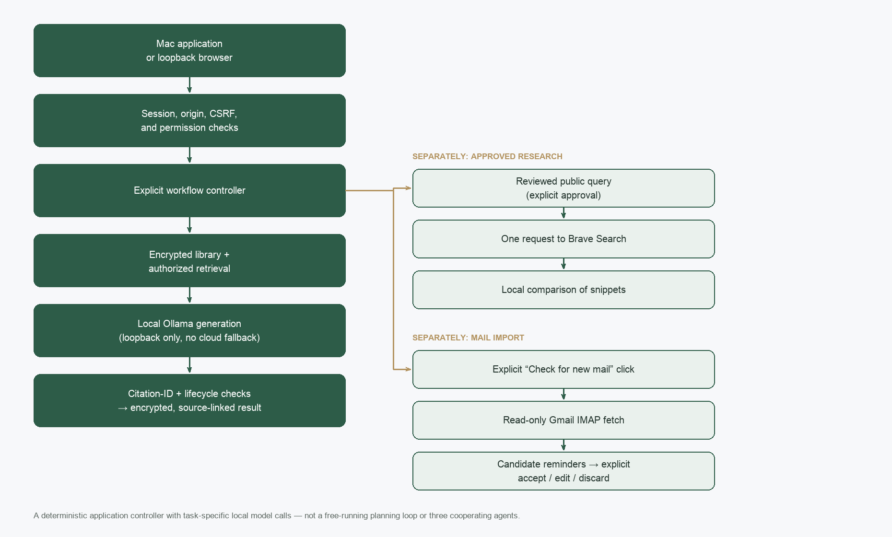

# Lumen: Final Capstone Report

**Module 7 — Capstone report planning draft**  
**Prepared:** November 17, 2026. **Revised:** November 19, 2026, to reflect work completed after the initial draft (Phase 3 evaluation tooling, the LangSmith synthetic-export option, a three-part UI revision, a settings/Ollama coupling fix, and an optional read-only Gmail import capability). Section 7's test counts and Section 3/9's scope claims were updated accordingly; other sections were revised only where the new work changed their accuracy.

This report follows the supplied final capstone planning template and describes the implemented source and documented results available on this date. Proposed extensions are identified separately. All examples are synthetic. Before final submission, add the public GitHub URL and confirm the exact Module 1–6 checkpoint chronology against the original submissions.

## 1. Project title

**Lumen: A Local-First, Permission-Aware Personal AI Assistant**

Lumen combines local language-model assistance with an encrypted personal library, evidence-based retrieval, and explicit user control over information access and consequential operations.

## 2. Problem and user

Personal information is often scattered across documents, notes, and messages. Finding a deadline, summarizing a long document, or preparing a reply can require repeated searching and copying between applications. A general-purpose language model does not know these personal facts unless the user supplies evidence, and a fluent answer may conceal missing or unsupported information.

My intended user is an individual working on a Mac who wants useful assistance without automatically uploading a personal library to a hosted model. A student or independent professional might ask about an authorized project document, save a preference, draft a message, or organize an exact reminder. These are intended use cases, not claims of a completed user study.

The design problem is therefore broader than generating text: the system must combine relevant evidence, understandable permissions, practical access, and honest failure reporting. Lumen aims to reduce information-management friction while preserving the user's ability to inspect sources and decide what happens next. Productivity gains remain a hypothesis to evaluate, not a measured result.

## 3. System goal and scope

My goal is a single-user assistant that can answer questions from authorized material, summarize imported documents, help draft messages, and support lightweight personal organization. Successful operation means retrieving permitted evidence, producing an inspectable response, honoring revocation and approval rules, and reporting failures without pretending that work was completed.

| In scope and implemented in source | Important boundary |
|---|---|
| Document import, extracted-text inspection, Q&A, and summaries | PDF, DOCX, UTF-8 TXT, and Markdown; scanned PDFs require prior OCR. |
| Notes and explicitly authorized preferences | No hidden automatic memory extraction. |
| Editable email drafts | No mailbox connection or sending capability; this remains true even with mail import (below) enabled. |
| Exact, timezone-aware reminders | In-app records, not OS notifications. |
| Optional, off-by-default, read-only Gmail import | Read-only IMAP with an app password; cannot send, delete, label, or modify mail. Import happens only on an explicit "Check for new mail" click, never in the background. Candidate reminders extracted from mail require explicit accept/edit/discard before becoming a real reminder. |
| Approved public research through Brave Search | Search snippets, not automatically fetched full articles. |
| Mac menu-bar interface, explicit sharing, and on-device dictation | No screen monitoring, app control, automatic clipboard polling, or always-listening mode. |

Lumen is intentionally a bounded, user-directed assistant rather than a general autonomous executor. It runs locally on an awake, logged-in device. The native application references the project and Python environment; it is not a self-contained, notarized public distribution. A separate home-lab cluster is not part of this deployment.

## 4. Final system architecture

### Current implemented architecture

The current system uses a deterministic application controller with task-specific local model calls. It does not implement a free-running planning loop or three cooperating AI agents.

```text
Mac application or loopback browser
    -> session, origin, CSRF, and permission checks
    -> explicit workflow controller
    -> encrypted library and authorized retrieval
    -> local Ollama generation
    -> citation-ID and lifecycle checks
    -> encrypted result and source-linked interface

Separately: reviewed public query -> one approved Brave request
           -> saved snippets -> local comparison

Separately: explicit "Check for new mail" click -> read-only Gmail IMAP
           -> encrypted mail_message records -> local extraction
           -> candidate reminders -> explicit accept/edit/discard
```



For document Q&A, Lumen extracts text into overlapping chunks of up to 2,000 UTF-8 bytes with approximately 150 bytes of overlap. Keyword overlap is the default retrieval method. Optional semantic retrieval embeds the question and authorized chunks through local Ollama, ranks cosine similarity, and supplies at most two passages above a heuristic 0.5 floor. That score is not a probability that an answer is correct. Explicit file attachment restricts the search to that file. Authorized, imported mail is chunked and retrieved the same way as documents and notes, so questions like "when does my flight leave" can be answered with a citation back to the specific message.

Full-document summarization follows a different path: every chunk is processed in batches, and partial summaries are recursively combined. This improves structural coverage compared with summarizing only retrieved excerpts, but does not guarantee that the final compression retains every fact. Document access, revision, and session are checked before and after each model stage.

Memory consists of encrypted records and explicitly authorized preferences. Recent conversation enters a new prompt only when enabled, is bounded to eligible recent turns, and is filtered against current source authorization. Notes, reminders, and draft saves use explicit controls; requested chat and research results are retained as encrypted records according to the documented workflow.

Mail import follows a one-way, read-only path that never produces a write without explicit review: an explicit click fetches a bounded window of inbox messages over IMAP (never marking them read, never sending), stores them encrypted, then asks the local model to extract only explicitly stated dates in small batches. The model's output is validated against the actual fetched batch — a reference to a message outside the batch, a missing timezone, or malformed JSON causes that single suggestion to be dropped rather than guessed at. Suggestions are never saved as reminders automatically; each requires an explicit accept, edit-then-accept, or discard.

### Reasoning and coordination decisions

I did not add Tree-of-Thought search. The main challenge is retrieving and faithfully communicating evidence, not exploring a branching action plan. Extra reasoning branches would increase local computation without establishing better source support. Chunk-and-combine summarization is hierarchical processing, not Tree of Thought.

A future design separates an Evidence Agent, Response Agent, and Review Agent under the same controller. It proposes sequential handoffs with one bounded revision. This architecture is documented but **not implemented or enabled**. It must demonstrate a quality benefit over the current baseline before becoming the default. Agents sharing one model may also share errors; review would not replace deterministic permissions or human judgment.

## 5. Design evolution across the program

The project's design story is a refinement from broad personal assistance toward evidence-grounded, explicitly permissioned workflows. The available artifacts support the changes below. They do not establish the exact order or content of every Module 1–6 submission, so this synthesis deliberately avoids inventing a module-by-module history. The engineering phases in the implementation plan are not course-module numbers.

| Documented refinement | Rationale and contribution |
|---|---|
| Defined bounded assistance instead of general autonomous action | Kept drafts, reminders, storage, and external requests under visible user control. |
| Made memory explicit and encrypted | Separated storing information from granting AI access; preferences remain inspectable and revocable. |
| Added optional local semantic retrieval alongside keyword search | Addressed vocabulary mismatch without introducing a hosted embedding service or plaintext vector index. |
| Assessed and rejected Tree-of-Thought reasoning for current tasks | Prioritized retrieval and evidence quality over unnecessary branching and latency. |
| Designed role-separated multi-agent review as a future extension | Clarified the responsibilities of evidence collection, writing, and review while recognizing coordination overhead. |
| Defined safety metrics and audited documentation against behavior | Distinguished proposed safeguards from real controls and exposed lifecycle bugs that ordinary success-path tests missed. |
| Built a versioned synthetic evaluation harness and an optional, hash-confirmed LangSmith export | Separated repeatable, scored development evaluation from unmeasured ad hoc testing, while keeping normal app use untraced. |
| Consolidated navigation and split Settings into independently saved sections | Replaced a dense, always-open interface with list-first saved views and setup sections that fail independently of each other. |
| Added optional, explicit, read-only Gmail import | Extended evidence-grounded assistance to a user's existing mail without expanding the app's write surface: import is read-only, suggestions require explicit review, and there is still no send capability anywhere in the app. |

The most concrete recent improvement came from that audit. It identified stale sharing authorization, continued summary reduction after revocation, deleted research being recreated by late completion, inconsistent embedding admission, saved-model readiness gaps, and retrieval documentation errors. These six issues were corrected in source and covered by regression tests. A seventh, similar issue surfaced later while building mail import: the settings page's background reload was not scoped to disable the right controls, allowing a stale reload to silently overwrite a just-submitted save; it was fixed the same way, by scoping the busy-state to the whole affected form group. This reinforced a central lesson: dependable behavior requires testing the boundaries between operations, not just checking whether the model produces an answer.

## 6. Implementation overview

Lumen uses Python 3.11+ with FastAPI and Uvicorn for the loopback backend. The web interface is plain HTML, CSS, and JavaScript. A Swift AppKit application hosts a nonpersistent WKWebView, manages its owned backend process, and provides menu-bar access, sharing, and native dictation.

| Component | Main technology and responsibility |
|---|---|
| Controller and API | `lumen/app.py`: validated inputs, sessions, permissions, model-work admission, approvals, and workflows. |
| Encrypted storage | `lumen/storage.py`: SQLite with AES-256-GCM and a Scrypt-derived key held while unlocked. |
| Document processing | `lumen/documents.py`: pypdf, python-docx, lxml, chunking, and retrieval. Original file bytes are not retained. |
| Inference | `lumen/inference.py`: HTTPX calls to loopback Ollama, model metadata checks, and context/output-limit failures. |
| Public research | `lumen/research.py`: fixed Brave Search API destination and bounded snippet results. |
| Mail import | `lumen/mail.py`: read-only IMAP fetch (stdlib `imaplib`/`email`), HTML-to-text extraction without rendering or remote fetches, and candidate-reminder output validation. No SMTP capability exists anywhere in the codebase. |
| Evaluation tooling | `lumen/evaluation.py`, `evaluation_scoring.py`, `scripts/evaluate.py`: an 18-case versioned synthetic dataset, an opt-in local runner, timing/call reports, and a human-scoring rubric. |
| Optional synthetic export | `lumen/langsmith_export.py`: offline preview and hash-confirmed upload of synthetic evaluation traces only; never instruments normal app use. |
| Native experience | Swift AppKit/WebKit, ServiceManagement, AVFoundation, and Speech; authorization checks precede OS content capture. |
| Validation | Pytest, mocked HTTP transports, Playwright browser checks, synthetic Swift checks, Ruff, and JavaScript syntax checking. |

Users choose an installed local chat model; `qwen3:4b` is one documented setup example, not a universally benchmarked choice. `nomic-embed-text` is the recommended optional embedding model. Lumen does not train a custom model, download models automatically, or silently substitute a cloud provider.

To reproduce the backend, install the project and development dependencies in a virtual environment, start Ollama with a chosen local model, and run `lumen`. The README provides complete browser, native-build, and optional-test instructions. No personal vault is needed for the automated tests.

## 7. Evaluation and results

### Deterministic behavior and regression testing

I evaluated application behavior separately from model quality. Synthetic inputs, temporary vaults, fake inference responses, and mocked search transports make permission and failure scenarios reproducible without using personal information.

The latest recorded validation on November 19, 2026 used `LUMEN_BROWSER_TESTS=1 .venv/bin/python -m pytest -q` and completed with **165 tests passed and 2 skipped** (up from 85 passed on November 17, reflecting the evaluation tooling, UI, and mail-import work added since). The skipped checks were the full native-app smoke test and the live-model smoke test. Ruff, JavaScript syntax checking, Swift source type-checking, and local documentation-link checks also passed. These are recorded development results, not a new independent certification.

| Evaluation area | Evidence and result |
|---|---|
| Authorization and session handling | Tests exercise unauthorized records, revocation, locking, and replacement sessions; the recorded suite passed. |
| Summary lifecycle | Ten regression cases cover map/reduction stages with revocation, deletion, edits, locking, or session replacement; work stops and earlier summaries remain intact. |
| Research and deletion | Tests confirm approval requirements, one-use requests, retained evidence on model failure, and no recreation after an approved in-flight deletion. |
| Sharing and readiness | Browser and fake-provider Swift checks cover fresh authorization, stale delivery, saved-model outages, and offline note saving without accessing a real clipboard. |
| Storage and error handling | Tests check encrypted persistence, wrong-passphrase behavior, conditional updates, invented citation IDs, and explicit failure on truncation or context overflow. |
| Mail import | Unit tests cover IMAP response parsing, message-ID deduplication, a 200-message batch cap verified against round-trip count (not per-message calls), credential-echo-free error handling, and candidate-reminder validation (unknown message references, naive dates, and malformed JSON are dropped, not guessed at), all against a fake IMAP double with no real network access. API tests cover account save/disconnect, the check-and-extract flow, accept/discard, access revocation, and inclusion in chat retrieval. |

### Synthetic scored evaluation and optional LangSmith export

Since the initial draft, I built a separate, opt-in evaluation harness distinct from the regression suite above: an 18-case versioned synthetic dataset (`tests/fixtures/evaluation/baseline-v1.json`) covering Q&A, summaries, drafting, missing/conflicting/stale evidence, prompt injection, high-impact advice, permission/history changes, and invalid input; a local runner that records timing and model-call counts; and a human-scoring rubric (`docs/evaluation/rubric.md`). A matching command can preview and, after an explicit local confirmation, upload only that synthetic run's traces and feedback to a private LangSmith project — this never instruments or traces normal app use. **No live, human-scored baseline has been collected yet**; the tooling exists, but the 90%/95%/90% targets below remain unmeasured.

### Model quality: evidence and remaining work

The retrieval checkpoint records a historical synthetic example: a household guide states that ending unused memberships could save USD 47 per month. Keyword retrieval did not match a paraphrased budgeting question; semantic retrieval supplied the relevant passage and figure. Revoking access removed that evidence. The example illustrates retrieval's influence but is not a statistically valid accuracy benchmark or a newly rerun model evaluation.

No defensible aggregate correctness, groundedness, calibration, or latency score has yet been established. The proposed targets—at least 90% answer correctness, 95% supported personal-fact claims, and 90% appropriate abstention—are **evaluation goals, not achieved results**. The scored-evaluation harness above provides the mechanism to measure them, but running it against a real model and completing human scoring remains future work. Passing tests with fake model answers cannot establish factual accuracy or prompt-injection resistance.

## 8. Safety and reliability considerations

Lumen applies defense in depth and least privilege. The backend accepts its exact loopback host/origin, uses session-bound CSRF checks, encrypts record contents, and locks after inactivity. Document/note authorization is distinct from storage. File-size, extraction, input, and context limits constrain processing, and only supported import formats are accepted.

External research requires review of an exact public query and an expiring, single-use approval. No personal records are automatically attached. Sensitive-pattern checks are incomplete, so the user must inspect the query itself. Brave receives the approved query, credential, and network metadata; opening a source link separately contacts that website.

Mail import follows the same least-privilege logic applied to a new, higher-stakes data source: the IMAP credential is an app password (not the account password), stored encrypted and never returned to the browser; the connection is read-only and the codebase has no SMTP capability to send, reply, or modify anything; import happens only on an explicit click, never on a schedule or in the background, since the application has no background process at all; and model-derived suggestions can only become a real reminder through an explicit accept, matching the existing approval philosophy rather than introducing a new one. A credential-echo check was added after noticing some IMAP servers include attempted credentials in failure text; errors are normalized before being shown.

Runtime checks reject results after relevant session or source changes. Conditional research updates ensure that deletion takes precedence over late completion. Model-work admission rejects overlapping expensive calls, including settings embedding validation. Ollama failures produce an explicit error or setup guidance, not cloud fallback. Notes and reminders remain available without inference. Lifecycle checks and status messages exist, but comprehensive per-stage monitoring and formal escalation policies remain future work.

Human oversight is already required for granting AI access, selecting reminder dates, saving reviewed drafts, external searches, mail-derived reminder suggestions, and deletions. Voice capture is explicitly initiated, on-device only, and places text in the input for review rather than submitting it automatically. Model prompts request clarification and uncertainty, but these behaviors are not yet a controller-enforced high-impact intervention policy. Users must inspect consequential dates, amounts, legal, medical, or financial conclusions and seek qualified advice when appropriate.

The trade-off is intentional: approvals and checkpoints reduce autonomy and add latency, but improve control and inspectability. Encryption protects data at rest, not an unlocked or compromised device. Current source fixes also require rebuilding the native app before the installed bundle receives them; type-checking and fake-provider tests do not establish real microphone accuracy or end-to-end OS behavior.

## 9. Limitations and next steps

The main limitations are bounded retrieval coverage, imperfect extraction, possible hallucinations, and local resource constraints. Only two passages enter ordinary Q&A; related evidence elsewhere may be missed. Embeddings are recomputed for each question, so a larger library increases latency. Parsers are not sandboxed, scanned documents need OCR, and long summaries can omit facts despite processing every chunk. Citation-ID validity is not proof of claim support.

Mail import adds its own bounded limitations: it supports one Gmail-style IMAP account, not multiple accounts or other providers' OAuth flows; each check is capped at 200 messages from a rolling 90-day window, so a very large inbox is not fully covered by one click; date extraction is a best-effort local-model task that can miss or misread a date, which is why every suggestion requires explicit review rather than being trusted automatically; and there are still no OS-level notifications — suggested and accepted reminders only surface while Lumen is open and unlocked.

The current application has no autonomous tool execution, multi-agent review pipeline, or formal risk-based escalation controller. A synthetic, scored evaluation harness now exists, but no live, human-scored baseline has been run against it yet. The application also has no passphrase recovery/change workflow, OS reminders, messaging/calendar integration, or self-contained notarized distribution.

The next priorities are:

1. Run the existing scored-evaluation harness against a real local model with human review, instead of only validating the harness itself with synthetic/fake responses.
2. Rebuild and explicitly verify the native sharing and speech experience with user consent and nonsensitive test material; separately, verify mail import against a real Gmail app password (only the IMAP double has been exercised so far).
3. Implement bounded three-role coordination only as an opt-in experiment, measuring quality gains against extra model calls and latency.
4. Add structured clarification/human-review outcomes and privacy-preserving local monitoring without weakening approvals.
5. Improve retrieval scaling only after measurements identify the bottleneck, preserving encryption, provenance, and revocation semantics.

The overall contribution is a working local-first assistant with inspectable permissions and tested application safeguards, accompanied by an explicit account of what remains unproven. More autonomy is not the success criterion; dependable, useful assistance at an acceptable local cost is.

## 10. Public GitHub repository

**Public repository URL: https://github.com/rajitnikhare/lumen** — created and reachable, but not yet populated as of this revision; the local commit is prepared and the push is pending. Creating this report does not publish the source or any local files.

Before final submission, publish a curated repository containing the README, application/native source, setup and test instructions, dependency configuration, synthetic examples, relevant design decisions, and shareable evaluation artifacts. Distinguish implemented features from planned work so an external reviewer can reproduce the demonstrated behavior.

Review every file and, if applicable, commit history before publication. Exclude real vaults, credentials, personal documents, recordings, local environments, generated bundles, private logs, and nonpublic infrastructure details. In particular, do not publish the separate home-lab runbook unchanged; omit it or create a deliberately sanitized public version. Do not copy private data into the repository merely because the application normally encrypts its vault.

The report's evidence is the project README, retrieval checkpoint, Tree-of-Thought assessment, proposed multi-agent architecture, safety/intervention plan, documentation audit, implementation plan, UI experience plan, evaluation guide/rubric, source, and tests. The recorded test result supports deterministic behavior in tested cases; it does not establish production certification. The final public repository should include a synthetic results artifact and a verified URL linking the report, code, and presentation.
